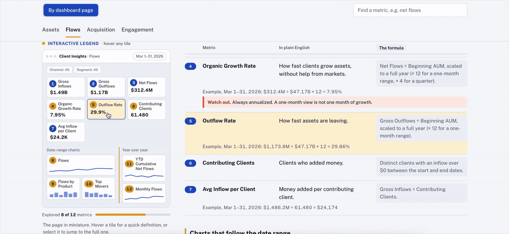

# Metric Map: Interactive Dashboard Documentation

**A metric nobody can explain is a metric nobody trusts.**
This is an interactive data dictionary for a BI dashboard. Hover any tile on a miniature version of the dashboard to see what the metric means, how it's calculated and when to use it.

**[▶ Live demo](https://USERNAME.github.io/REPO-NAME/)**

> **Data note:** This is a sanitized replica. "Corvane Asset Management" is a fictional financial institution, and every metric, number and definition here is made up for demonstration. The approach comes from a real documentation gap I solved at work.

---

## The business problem

Dashboards rarely ship with metric definitions. When a stakeholder needs to quote a number, say for a client meeting, the only way to confirm what it means is to ask the analyst, who traces it back to the SQL.

Typical questions:
- "Does Net Flows include dividends?"
- "Who counts as an active client?"
- "Is AUM growth coming from clients or the market?"

The analyst can answer. Nobody else can check for themselves. That slows teams down and makes people nervous to quote numbers.

## Who it's for

Strategy, client services, data warehouse and analytics teams, and potentially clients: anyone who reads the dashboard and needs to trust what it says.

## What it does

| Feature | Why it matters |
|---|---|
| **Interactive legend:** a miniature, numbered version of each dashboard page | Maps every tile to its definition visually, so users don't have to search by name |
| **Plain English + formula,** side by side | Business users read the meaning; analysts check the logic |
| **Worked examples** with real-looking numbers | Shows exactly how each KPI is computed |
| **"Watch out" notes** | Flags the gotchas before someone quotes the wrong number, e.g., two metrics both called "Net Flows" that are calculated differently |
| **Search, pinned column labels, progress tracker** | Faster lookup and easy orientation on long pages |

Metrics covered span four dashboard pages (Assets, Flows, Acquisition, Engagement), including AUM, fee-earning AUM, effective fee rate, net flows, organic growth rate, funding rate, active clients and 12-month retention.

## Approach

1. **Went to the source.** Started from the dashboard's underlying warehouse tables.
2. **Reverse engineered one KPI by hand,** tracing it from the dashboard tile back to its SQL logic.
3. **Scaled it with AI.** Used that first definition as the template for an AI assistant (Claude) to draft the rest.
4. **Verified every definition myself.** AI drafted; I validated.
5. **Designed for the reader.** Turned the definitions into a stakeholder-ready, interactive page built around how people actually read dashboards: by tile, not by metric name.

## Design decisions

- **The dashboard is the legend.** Numbered pins link each tile to its definition, borrowing the hotspot pattern from interactive product walkthroughs.
- **Light theme, one accent color.** Light mode reads faster, and semantic red is reserved for warnings.
- **Column labels that follow you.** Sticky "In plain English / The formula" labels keep long pages readable.
- **Built for every audience.** Each definition answers what the metric is, how it's calculated and why it matters, for technical and business readers alike.

## Outcome

Documentation like this usually takes weeks, if not months, of back-and-forth. With AI, it came together in a fraction of the time, and it's more usable thanks to the interactive visual elements. It's a reusable pattern for any dashboard where people ask "which number do I use?"

## Skills demonstrated

`Data documentation` · `Data dictionary / metric definitions` · `KPI development` · `SQL logic tracing` · `Business intelligence` · `Financial metrics (AUM, net flows, fee rates, retention)` · `AI-assisted analytics workflows` · `Data visualization & UX` · `Stakeholder enablement` · `HTML / CSS / JavaScript`

## Files

| File | What it is |
|---|---|
| `metric-map-legend.html` | The focused metric map: dashboard pages with the interactive legend, as shown in the demo |
| `metric-guide-full.html` | The complete guide in the same design: dashboard pages, "By question," "Cheat sheet," "Before you quote a number" and search |
| `metric-guide-v1-original.html` | The first version, kept to show how the design evolved |
| `assets/demo.gif`, `assets/demo.mp4` | Screen recording of the interactive legend |

**To run it:** download either HTML file and open it in a browser. No install, no build step.

---

**Cameron Partee** · Data analyst · **[▶ Live demo]([(https://www.linkedin.com/in/cameronpartee/)])**
